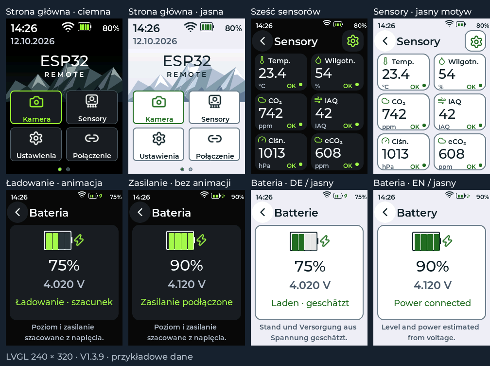

# V1.3.9 — bateria i czytelne sensory

Procent w nagłówku i na stronie baterii pochodzi z tej samej próbki AppState.
Oba wskazania aktualizują się na bieżąco, także po zmianie poziomu zasilania.
Poprzednio duży procent odświeżał się dopiero po ponownym wejściu na stronę.

Pomiar ADC co 500 ms używa mediany 16 próbek i filtrowania napięcia. Zachowano
krzywą procentową dla baterii; próg 4,1 V nie wymusza sztucznego wyniku 100%.

| Zaobserwowane napięcie | Wskazanie |
|---|---|
| Wzrost o co najmniej 30 mV w oknie 2 s, poniżej 4,1 V | Piorun i animowane zielone segmenty; ładowanie szacowane |
| Co najmniej 4,1 V przez 2 s | Piorun pozostaje, segmenty pokazują poziom bez animacji |
| Spadek poniżej 4,06 V o co najmniej 65 mV od maksimum przez 2 s | Powrót do wskaźnika baterii bez pioruna |
| Niewielkie wahania przy 4,1 V | Histereza utrzymuje ikonę zasilania bez migotania |
| Niepoprawny pomiar ADC | Kreska zamiast procentu i napięcia |

Wykrywanie opiera się na obserwacji użytkownika dotyczącej tej płytki. Samo
napięcie nie potwierdza obecności kabla, prądu ładowania ani zakończenia ładowania.
Na stronie znajduje się informacja, że poziom i zasilanie są szacowane. Bateria
o wysokim napięciu po odłączeniu kabla może przez pewien czas zachować piorun.

Strona baterii mieści poziom, napięcie, ikonę i stan na jednym ekranie, również
po niemiecku. W obu motywach ma zielone segmenty; niski poziom bez zasilania
jest oznaczony czerwienią. Animacja i piorun są także widoczne w nagłówkach.

Strona główna ma większą godzinę, datę 18 px oraz większe Wi-Fi i baterię.
Data pochodzi z NTP; bez czasu sieciowego widoczny jest placeholder. Wi-Fi ma
grubszy kontur. Ikona sensorów przedstawia moduł z kontaktami pogo — to oryginalny
rysunek zapisany jako SVG i zasób firmware, bez zależności od karty SD.

Ekran sensorów pokazuje wszystkie sześć pomiarów w dwóch kolumnach i trzech
wierszach, bez przewijania. Kafelki 108 × 76 px zawierają duże wartości, nazwy,
jednostki oraz stany OK / Alarm / Brak. Kolor alarmu reaguje na ustawione progi;
nieaktualny pomiar jest zastępowany kreską. Dotknięcie kafelka otwiera wykres,
a koło zębate prowadzi do ustawień i skanowania I²C.

Testy obejmują krzywą procentową, szum, okno wzrostu, opóźnienia, histerezę,
odłączenie, błędne napięcie i przepełnienie licznika czasu. Renderer PL/DE/EN
sprawdza zgodność obu procentów, 100%, animację i nieruchomy piorun, widoczność
wszystkich pomiarów, alarmy, brak danych oraz dotyk. Dotychczasowe testy kamery,
OTA, TLS, klawiatury i obu motywów pozostają w procesie wydania.

Ustawienia i schemat NVS nie zmieniły się. OTA zachowuje konfigurację oraz SD.
Testy na fizycznej płytce pozostają do wykonania, zwłaszcza zachowanie wskaźnika
przy podłączaniu i odłączaniu USB w różnych stanach naładowania.
