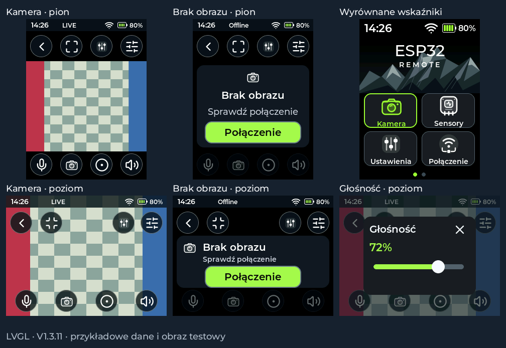

# V1.3.11 — kamera w poziomie i wyrównane wskaźniki baterii

W zwykłym podglądzie obraz jest widoczny w całości w pionowym układzie 240×320.
Górny pasek przycisków, obszar obrazu 240×180 i dolne przyciski są rozdzielone.
Komunikat **Brak obrazu** nie nachodzi na nagrywanie ani audio. Osobny przycisk
**Połączenie** prowadzi do WLAN/Bluetooth/ESP i umożliwia powrót do kamery.
Podgląd ma ciemne tło w obu motywach; niezainicjalizowany obraz jest ukryty.

Przycisk pełnego ekranu przełącza **cały interfejs kamery do poziomu 320×240**.
Obraz QVGA zajmuje cały ekran bez przycinania krawędzi. Obróć pilot o 90° w prawo.
Po wejściu do pełnego ekranu gotowy obraz ma ukryte paski. Dotknij obrazu, aby
pokazać przyciski; ponowne dotknięcie chowa je. Przycisk zmniejszenia przywraca
pion, a strzałka wyjścia wraca do pionowej listy kamer. Ustawienia kamery otwierają
się w pionie; powrót do podglądu zachowuje jego wcześniejszy tryb.

Dotyk obraca się razem z obrazem. LCD pozostaje fizycznie w trybie natywnym
240×320, a LVGL obraca przesyłane fragmenty. Sterownik SPI i bazowe ustawienia
kontrolera nie są przełączane. Ta funkcja działa przyciskiem; nie wymaga
akcelerometru i nie wykrywa samodzielnie położenia pilota.

Regulacja głośności mieści się w obu orientacjach. Otwarta regulacja zachowuje
roboczą wartość przy zmianie motywu. Zdjęcie, nagrywanie, odsłuch oraz przytrzymanie
mikrofonu działają w obu układach. Funkcje wymagające kamery/audio/SD pozostają
nieaktywne, gdy sprzęt lub połączenie są niedostępne.

Wi-Fi, obrys baterii i widoczne cyfry mają wspólną linię środkową w nagłówkach.
Bateria jest od tekstu procentów oddalona o 4 px, Wi-Fi od baterii o 8 px.
Odstępy aktualizują się od razu dla 0–100%, braku odczytu i pojawienia się pioruna.
Poprawiono położenie segmentów wewnątrz obrysu, miejsce na piorun oraz centrowanie
dużej ikony na stronie baterii. Sposób pomiaru i szacowania ładowania pozostaje
zgodny z V1.3.9; próg 4,1 V nadal zatrzymuje animację i pozostawia piorun.

Testy korzystają z rzeczywistego LVGL, obrotu fragmentów ekranu i surowych
współrzędnych dotyku. Każdy piksel poziomego obrazu jest porównywany z buforem
przekazywanym do natywnego ekranu 240×320. Sprawdzane są też powrót do pionu,
przyciski nagrywania/audio/zdjęcia, ustawienia, zachowanie głośności, brak obrazu,
PL/DE/EN i oba motywy. Test nagłówków mierzy widoczne piksele cyfr, odstępy,
segmenty i brak kolizji aż do 100%. Dotychczasowe testy BLE, baterii, OTA, TLS,
transportu LCD i logów pozostają w procesie wydania.

Działanie na fizycznym pilocie, zwłaszcza płynność po obrocie oraz orientacja
dotyku, wymaga sprawdzenia na sprzęcie. OTA zachowuje Wi-Fi, kamerę, sensory,
motyw i dane na SD. Instalacja: **System → Software → Sprawdź → Aktualizuj → Potwierdź**.
