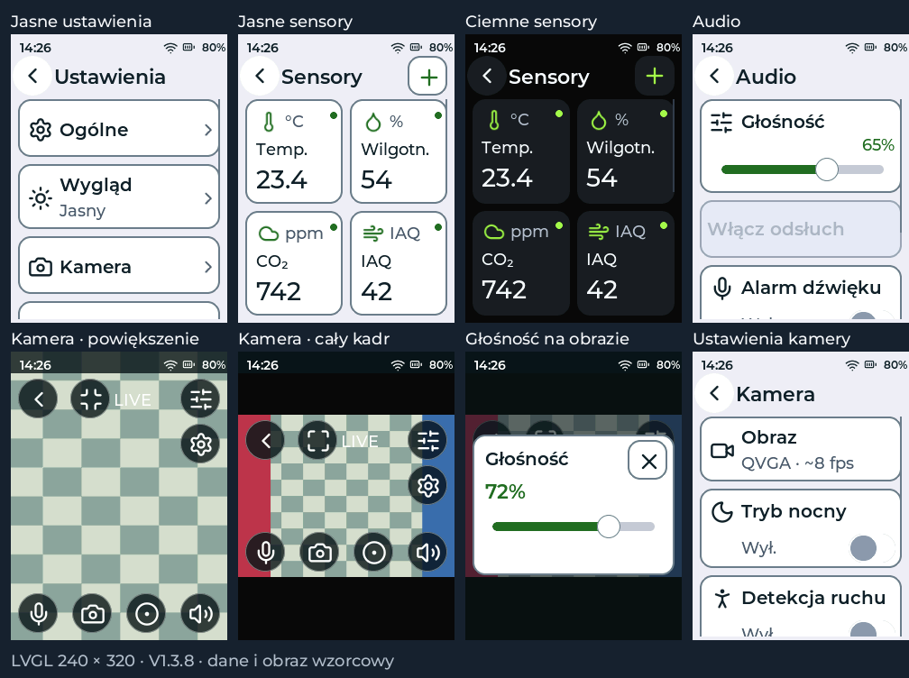

# V1.3.8 — sensory, kamera i osobne audio

Jasny motyw ma ciemniejsze obramowania kart i większą różnicę między kartą a tłem.
Ustawienia zawierają osobne strony Kamera i Audio. Audio grupuje głośność, odsłuch,
alarm dźwięku i mówienie; Kamera grupuje obraz, tryb nocny, ruch i nagrania.

Sensory mają sześć dużych kafelków w dwóch kolumnach: nazwa, jednostka, aktualna
wartość i wskaźnik dostępności. Dotknięcie kafelka otwiera wykres. Dalsze pomiary
i ustawienia są dostępne przez przewijanie; przycisk plus otwiera wyszukiwanie.
Brak lub nieaktualne dane pokazują kreskę zamiast starego odczytu.

Podgląd kamery wypełnia ekran 240 × 320 bez nagłówka Kamera 1. Przyciski na obrazie
obsługują powrót, cały kadr/powiększenie, głośność, ustawienia kamery, przytrzymanie
mikrofonu, zdjęcie, nagrywanie i odsłuch. Dotknięcie wolnej części obrazu chowa lub
pokazuje przyciski. Przełączenie kadru nie zmienia pliku zdjęcia ani nagrania.
Cały kadr zachowuje obraz 4:3 i czarne pasy; powiększenie przycina boki.

Bufory obrazu 320 × 240 używają PSRAM. Brak obrazu jest sygnalizowany, a funkcje
wymagające kamery, audio lub SD są blokowane, gdy te zasoby są niedostępne.
Przyciski mają pola dotykowe co najmniej 44 × 44 px.

Ikony w całym interfejsie pochodzą z jednej wersji Lucide. Źródło i licencja są
w assets/LUCIDE_SOURCE.json i assets/Lucide-LICENSE.txt. Ciemna strona główna ma
zachowany układ, tekst i kolory; zmieniono na niej wyłącznie ikonki.

Sprawdzono 150 ekranów PL/DE/EN w obu motywach, duże cele dotykowe, przewijanie,
klawiaturę, aktualizacje odczytów, nawigację do wykresu, rozdział ustawień audio,
przyciski i gesty podglądu, zapis głośności oraz działanie OTA w rendererze LVGL.
Test geometrii sprawdza zachowanie proporcji, przycięcie oraz pokrycie całego
bufora podczas dekodowania QVGA i VGA. Testy OTA, TLS, motywu, LCD i pakowania
pozostają w procesie wydania. Testy na fizycznym pilocie pozostają do wykonania.

Aktualizacja OTA zachowuje konfigurację i dane SD. Po wcześniejszej instalacji
merged, bez późniejszego przełączenia slotu OTA, plik firmware.bin można wgrać
przez USB pod 0x10000 bez Erase all. Po udanym OTA użyj ekranu aktualizacji;
sam zapis pod 0x10000 nie wybiera aktywnej partycji. Obraz firmware-merged.bin
pod 0x0 przeznaczono do czystej instalacji i usuwa ustawienia.
