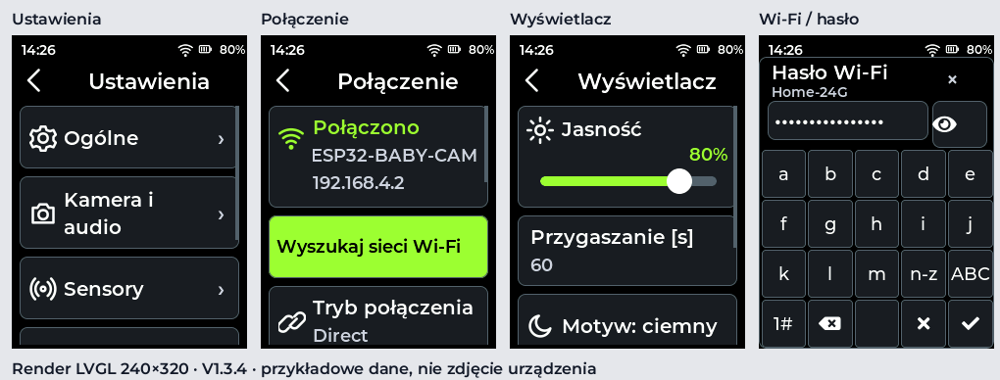

# V1.3.4 — większe napisy i dotyk

Strona główna została zachowana **piksel w piksel** w językach PL, DE i EN.
Zmieniono podstrony, bez zmian sterownika LCD, orientacji, kolorów ani schematu NVS.

| Element | V1.3.4 |
|---|---|
| Główne opisy | Montserrat SemiBold 20 px; długie słowa 18 px |
| Wartości i objaśnienia | Zwykle 18 px zamiast 12–14 px |
| Tytuły | 22 px, dopasowanie do 20/18 px przy długich nazwach |
| Wiersze ustawień | Minimum 64 px, więcej przy kilku liniach |
| Wstecz / zamknięcie | 44×44 px |
| Stałe przyciski skanu / OTA | 224×52 px |
| Sterowanie kamerą | 52×52 px |
| Przełącznik | 52×32 px plus powiększony obszar dotyku; aktywny cały wiersz |
| Klawiatura | 5 kolumn, 4 wiersze; każdy klawisz co najmniej 44×44 px |

Listy przewijają się pionowo. Nazwy i wartości mają własne linie; odstępy są wyliczane
z rzeczywistej wysokości napisów. Przełącznik reaguje na dotknięcie opisu lub samego
suwaka, bez podwójnego wywołania. Niedostępne funkcje kamery pozostają zablokowane.

Klawiatura ma dwie strony liter (a–m / n–z), duże litery, cyfry i dwie dalsze strony
znaków. Wszystkie drukowalne znaki ASCII są dostępne. Ikona oka pokazuje/ukrywa hasło;
maskowanie, limity długości, 64 HEX i sprawdzanie hasła Wi-Fi pozostają włączone.

Podgląd kamery zachowuje obraz 224×168; większe karty temperatury/wilgotności są pod
obrazem i można do nich przewinąć. Duże przyciski kamery pozostają przy dolnej krawędzi.
OTA pokazuje stan/błąd na górze oraz stale dostępne większe przyciski poniżej; opis
wydania i numery wersji można przewijać. Zachowano poprawkę HTTPS z V1.3.3.

Podgląd to render rzeczywistego LVGL 240×320 z przykładowymi danymi, nie zdjęcie pilota.

## Sprawdzenie

Testy ASan/UBSan renderują podstrony w PL/DE/EN i sprawdzają rozmiary obszarów dotyku,
brak nakładania sąsiednich elementów oraz dotarcie do ostatniego elementu listy.
Testy z wirtualnym wejściem wskaźnika obejmują dotknięcie opisu przełącznika,
dotknięcie jego suwaka, blokadę niedostępnej funkcji i przewijanie bez aktywacji wiersza.
Klawiatura jest testowana dla wszystkich drukowalnych znaków ASCII. Zrzuty strony
głównej są automatycznie porównywane z referencjami V1.3.3.

Potrzebny jest test na fizycznym pilocie; programowe testy nie weryfikują kalibracji
dotyku ani jakości panelu LCD.

## Instalacja

Z działającej V1.3.3: **System → Aktualizacja OTA → Sprawdź → Zainstaluj → Potwierdź**.
OTA zachowuje NVS i SD. Jeżeli klient V1.3.1/V1.3.2 nadal nie zestawia HTTPS, użyj
jednorazowo USB zgodnie z [instrukcją V1.3.3](OTA_FIX_V1_3_3.md): aplikacja pod
0x10000 po instalacji merged i przed udanym OTA, bez „Erase all”.
Plik merged pod 0x0 jest wyłącznie do czystej instalacji i usuwa ustawienia.
