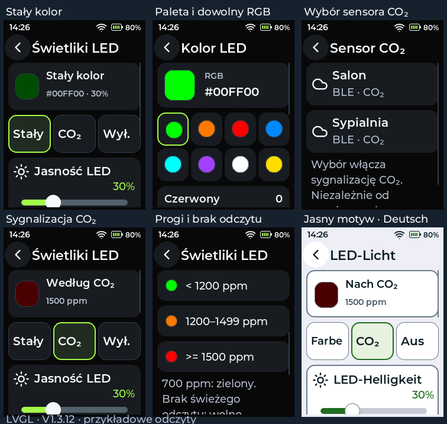

# Świetliki LED — V1.3.12

Obsługa jednej tylnej **WS2812B na GPIO42** płytki LCDWIKI ES3C28P. Kanały
świetlne obudowy przekazują jej światło na obie strony: mają **wspólny kolor**,
nie można sterować lewą i prawą stroną niezależnie. To nie jest podświetlenie LCD
ani dioda układu ładowania. Oprogramowanie nie zmienia obudowy ani połączeń PCB.

## Uruchamianie

- Czerwony od wejścia do aplikacji, przed LCD, PSRAM i LVGL.
- Po pomyślnym uruchomieniu UI i zadań: zielony przez 1,5 s, bez opóźniania UI.
- Potem wybrany tryb pracy. Błąd krytyczny startu pozostawia czerwony.
- Kolor nie może sygnalizować etapu ROM/bootloadera przed startem aplikacji.
  Zielona gotowość nie potwierdza połączenia Wi-Fi ani obecności wszystkich sensorów.

## Ustawienia

**Ustawienia → Świetliki LED** (również z ustawień sensorów):

- **Stały:** 8 gotowych kolorów lub dowolny RGB za pomocą trzech suwaków.
- **CO₂:** wskaż dodany sensor z rzeczywistym pomiarem CO₂: SCD41 POGO lub
  zgodny sensor Bluetooth BTHome v2, udostępniający obiekt CO₂.
- **Wył.:** LED wygaszona po sekwencji startowej.
- Osobna jasność LED 0–100%, domyślnie 30%. Jasność LCD pozostaje bez zmian.

Wyboru sensora dokonuje się niezależnie od wartości wybranej na ekranie głównym.
eCO₂ z BME688 nie jest używane zamiast CO₂. Wybór źródła zapisuje jego tożsamość
(typ oraz adres), nie numer w liście. Usunięcie/przesunięcie innego sensora nie
przypisze sygnalizacji przypadkowemu urządzeniu.

| Świeży odczyt CO₂ | Kolor przy rosnącym stężeniu |
|---|---|
| poniżej 1200 ppm, np. 700 ppm | Zielony |
| 1200–1499 ppm | Pomarańczowy |
| od 1500 ppm | Czerwony |
| brak wybranego sensora, brak lub nieaktualny odczyt | Wolne miganie niebieskie |

Przy spadku obowiązuje histereza 50 ppm: czerwony ustępuje poniżej 1450 ppm,
pomarańczowy poniżej 1150 ppm. Wzrost zmienia kolor dokładnie przy 1200/1500 ppm.
Brak danych nigdy nie oznacza zielonego. Odczyt jest aktualny przez 30 s dla POGO,
180 s dla BTHome; sprawdzany jest znacznik czasu samego CO₂, nie innego pomiaru.
Te progi są zachowaniem produktu, nie certyfikowanym alarmem bezpieczeństwa.
Są niezależne od progu powiadomień `CO₂ max` w ustawieniach alarmów.

Konfiguracja LED ma osobny klucz NVS `led-config` oraz `led-schema=1`.
Dotychczasowy 264-bajtowy `Settings` i konfiguracja sensorów pozostają bez zmian.
Aktualizacja aplikacji zachowuje Wi-Fi, kamerę, sensory oraz pliki SD. Reset
ustawień usuwa również wybór LED. Starszy firmware ignoruje nowe klucze.

## Sterownik i testy

Wbudowany sterownik Arduino-ESP32 2.0.17 `neopixelWrite` używa RMT i kolejności GRB.
LED jest obsługiwana tylko przez zadanie pętli, co najwyżej co 100 ms, a ramka
jest wysyłana wyłącznie przy zmianie koloru. Bez dodatkowej biblioteki, zadania,
zajmowania I²C, kanału PWM LCD ani kopiowania całego `AppState` na stos.

Testy na PC obejmują progi, histerezę, utratę danych, NaN, TTL każdego pola,
przepełnienie `millis()`, start/gotowość, RGB, jasność, wyłączenie, zapis/odczyt
NVS i uszkodzoną konfigurację. Rzeczywisty LVGL testuje dotyk, wybór źródła,
zapis koloru po puszczeniu suwaka, zachowanie szkicu RGB i pozycji przewinięcia
przy zmianie motywu oraz brak zmian strony głównej w PL/DE/EN.

Wymagany test fizyczny: kolejność kolorów, światło w kanałach na USB i baterii,
dobór jasności, odłączenie sensora i reakcje 700/1200/1500 ppm. Symulator i
kompilacja nie potwierdzają jasności ani działania diody na realnej płytce.

Źródła sprzętowe producenta:

- [Schemat ES3C28P](https://www.lcdwiki.com/res/ES3C28P/2.8inch_ESP32-S3_Display_Schematic.pdf)
- [Instrukcja: RGB LED](https://www.lcdwiki.com/res/ES3C28P/2.8inch_IPS_ESP32-S3_ES3C28P_ES3N28P_User_Manual.pdf)
- [Mapa GPIO: RGB IO42](https://www.lcdwiki.com/2.8inch_ESP32-S3_Display_E32C28P/E32N28P)
- [Sterownik Arduino-ESP32 2.0.17](https://github.com/espressif/arduino-esp32/blob/2.0.17/cores/esp32/esp32-hal-rgb-led.c)

Podgląd rzeczywistych ekranów LVGL (dane przykładowe):

