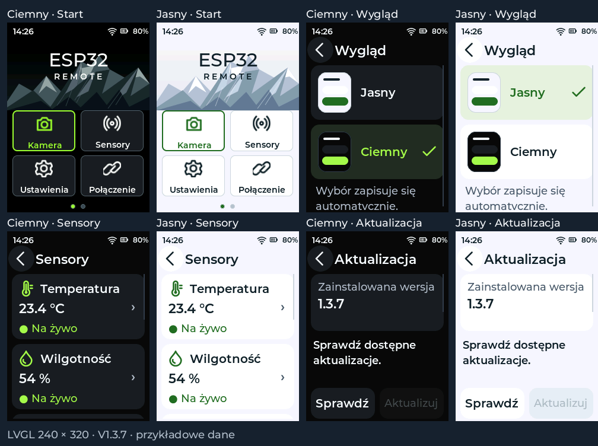

# ESP Remote V1.3.7 — Jasny / Ciemny

Podgląd jest wyrenderowany z kodu firmware w LVGL 8.3.11, 240 × 320.
Nazwy sieci, odczyty sensorów i bateria są przykładami; to nie jest zdjęcie pilota.

## Wybór

**Ustawienia → Wygląd → Jasny / Ciemny**. Druga droga:
**Ustawienia → Ogólne → Wyświetlacz → Wygląd**.

Zmiana działa od razu, bez restartu i dodatkowego przycisku zapisu. Wybór pozostaje
po ponownym uruchomieniu. PL: Jasny / Ciemny; DE: Hell / Dunkel; EN: Light / Dark.
Ciemny jest ustawieniem domyślnym po aktualizacji. Reset ustawień przywraca ciemny.

Jasny motyw ma białe karty, ciemne napisy, ciemną zieleń akcentów i jaśniejsze góry
na ekranie głównym. Obejmuje wszystkie podstrony, klawiaturę, komunikaty, suwaki,
przełączniki i pasek stanu. Układ i duże pola dotykowe są wspólne dla obu motywów.
Obraz z kamery oraz próbki w teście kolorów zachowują oryginalne kolory.
Ciemny ekran główny jest identyczny piksel w piksel z wcześniejszą wersją PL/DE/EN.

## Zapis i zgodność

Klucz `remote-v1/theme` jest niezależny od bloku `settings` schema1. Blok pozostaje
264-bajtowy z identycznymi pozycjami pól; Wi-Fi, hasło i token kamery nie wymagają
migracji. Brak klucza lub nieprawidłowa wartość oznacza motyw ciemny. Karta SD pozostaje
na nagrania i logi. Grafika jasnych gór jest w pamięci programu; nie wymaga SD.

## Sprawdzenie

- Rzeczywisty LVGL pod ASan/UBSan: 144 ekrany obu motywów w trzech językach,
  duże pola dotykowe, przewijanie, klawiatura, stany i blokady OTA.
- Dotyk na miniaturach i opisach motywów; brak ponownego zapisu aktywnego wyboru.
- Prawidłowy powrót do ustawień lub wyświetlacza i odświeżenie stron pomiaru/skanowania.
- Zachowanie hasła, maskowania, wybranej sieci i strony symboli przy zmianie motywu.
- Zapis/odczyt klucza, ponowne uruchomienie modelu, uszkodzone wartości, błąd zapisu
  i nienaruszony blok schema1 w teście produkcyjnych funkcji zapisu/odczytu.
- Kontrast tekstów jasnego motywu co najmniej 4.5:1 po kwantyzacji RGB565.
- Kompilacja pilota i niezależnego testu LCD oraz dotychczasowe testy OTA/TLS.

Wygląd, zapis w fizycznej pamięci NVS i działanie OTA na pilocie wymagają potwierdzenia.

## Instalacja

Z V1.3.6: **Ustawienia → System → Aktualizacja → Sprawdź → Aktualizuj → Potwierdź**.
Wymagany router z internetem i czas NTP. Aktualizacja aplikacji zachowuje konfigurację.

Przy niedziałającym HTTPS w V1.3.1–V1.3.4 potrzebne jest jednorazowe USB.
Po dotychczasowej instalacji merged i bez udanego OTA: `bin/firmware.bin` pod `0x10000`,
bez Erase all. Jeśli OTA wybrało inny slot, sam zapis pod `0x10000` nie zmienia aktywnego
slotu. `firmware-merged.bin` pod `0x0` służy do czystej instalacji i usuwa ustawienia.

Grafikę jasnych gór można odtworzyć przez `python tools/make_light_assets.py`
po instalacji `tools/requirements.txt`.
