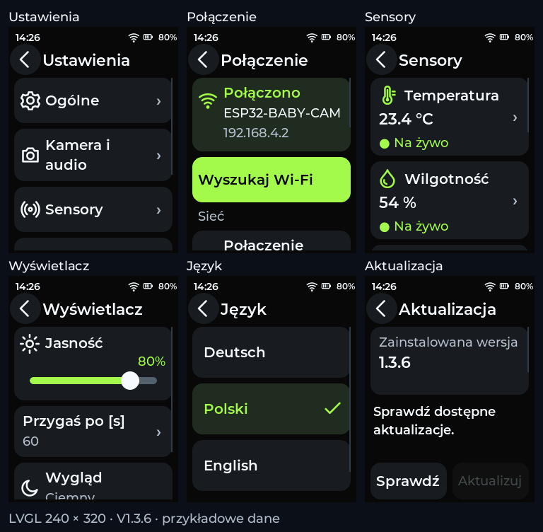

# ESP Remote V1.3.6 — odświeżone podstrony

Podgląd powstał z kodu firmware w rendererze LVGL 8.3.11 w rozdzielczości
240 × 320. Dane sensorów, nazwy sieci i poziom baterii są przykładami.
To nie jest zdjęcie fizycznego urządzenia.

## Wygląd i teksty

- Grafitowe karty, brak jasnych ramek i cieni. Limonka wskazuje aktywne funkcje.
- Tytuły SemiBold 20/22 px; dłuższe nazwy 18 px. Opisy Medium 18 px.
- Spójne przyciski powrotu, strzałki w wierszach, widoczna informacja o wyborze języka.
- Lżejsza klawiatura z dotychczasowymi dużymi klawiszami i maskowaniem hasła.
- Prostsze teksty polskie, niemieckie i angielskie; edytory mają nazwy właściwych pól.
- Wi-Fi: osobna karta stanu oraz grupy ustawień sieci i kamery.
- Sensory: wartość i jednostka na liście, odświeżane wraz z pomiarami; brak danych ma odrębny stan.
- OTA: karta wersji, komunikat widoczny bez przewijania, przyciski Sprawdź / Aktualizuj.
  Instalacja wymaga drugiego dotknięcia Potwierdź i jest związana z wyświetloną wersją.

## Zachowana zgodność

Strona główna jest identyczna piksel w piksel PL/DE/EN. Pola dotykowe na podstronach
mają co najmniej 44 × 44 px. Długie listy pozostają przewijane; tekst nie jest pomniejszany
do dopasowania całej strony. Sterownik LCD, orientacja, schemat ustawień NVS i poprawka
alokatora TLS z V1.3.5 są zachowane. Aktualizacja aplikacji nie zapisuje plików na SD.

## Sprawdzenie

`tools/render_ui.py` uruchamia rzeczywisty LVGL pod ASan/UBSan. Kontroluje trzy języki,
odstępy i brak nakładania elementów list, dotyk, klawiaturę, koniec przewijania, odświeżanie
sensorów, mieszczące się komunikaty OTA, potwierdzenie i blokady instalacji oraz identyczność
strony głównej. Workflow buduje pilot i niezależny test LCD przed opublikowaniem wydania.
Wygląd, działanie HTTPS/OTA i pomiary na fizycznym pilocie wymagają potwierdzenia użytkownika.

## Instalacja

Z V1.3.5 można spróbować OTA: **Ustawienia → System → Aktualizacja → Sprawdź →
Aktualizuj → Potwierdź**. Potrzebny router z internetem i zsynchronizowany czas.

Przy niedziałającym HTTPS w V1.3.1–V1.3.4 potrzebne jest jednorazowe USB.
Po dotychczasowej instalacji merged i bez udanego OTA: `bin/firmware.bin` pod `0x10000`,
bez Erase all, zachowuje ustawienia. Jeśli wcześniejsze OTA wybrało inny slot, sam zapis
pod `0x10000` nie przełącza aktywnej partycji. `firmware-merged.bin` pod `0x0` służy do
czystej instalacji i usuwa ustawienia.
