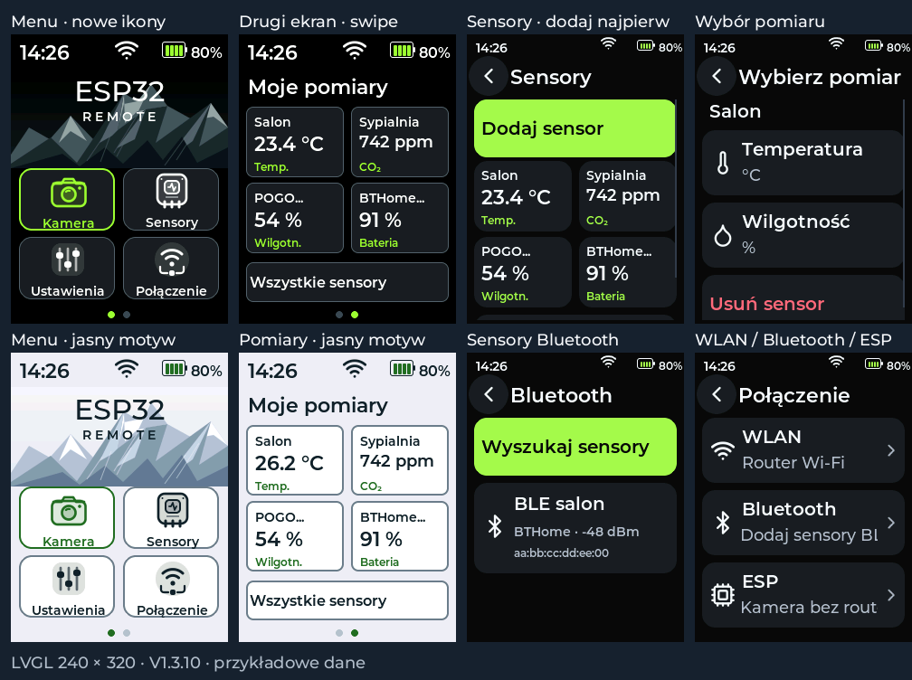

# V1.3.10 — sensory Bluetooth i dwa ekrany główne

Na stronie **Sensory** pierwsza opcja to **Dodaj sensor**. Po dodaniu urządzenia
wybiera się jeden z jego udostępnianych pomiarów. Pilot pamięta maksymalnie cztery
sensory i ich wybór po restarcie, w osobnym wpisie NVS. Dotychczasowa konfiguracja
Wi-Fi/kamery (Settings schema1, 264 bajty) pozostaje zgodna.

**Sensory → Dodaj sensor → Bluetooth → Wyszukaj sensory → urządzenie → pomiar**.
Wyszukiwanie trwa 15 s i pokazuje nazwę, adres oraz siłę sygnału. Obsługiwane są
rozgłoszenia BTHome v2 bez szyfrowania oraz czytelne charakterystyki BLE ESS.
Nie jest to parowanie telefonu ani dowolny protokół producenta. Zapis urządzenia
następuje dopiero po rozpoznaniu pomiarów. Zaszyfrowany BTHome jest oznaczony;
obsługa kluczy szyfrowania nie jest zaimplementowana.

| Źródło | Pomiary |
|---|---|
| BTHome v2, UUID FCD2 | Temperatura, wilgotność, CO₂, ciśnienie, bateria sensora |
| Environmental Sensing 181A | Temperatura 2A6E, wilgotność 2A6F, ciśnienie 2A6D; opcjonalnie bateria 180F/2A19 |
| POGO BME688 | Temperatura, wilgotność, IAQ, ciśnienie, eCO₂ |
| POGO SCD41 | Temperatura SCD41, wilgotność SCD41, CO₂ |

BTHome jest odbierany w tle; ESS odczytywany kolejno co 15 s przez połączenie
BLE. Charakterystyki wymagające własnego protokołu, kodu PIN lub klucza nie są
obsługiwane. Urządzenia ze zmieniającym się adresem prywatnym wymagają dodatkowej
obsługi tożsamości. Przy kilku pomiarach tego samego typu BTHome wyświetlany jest
pierwszy. Nieprawidłowy pakiet nie odświeża danych. Każdy pomiar ma własny znacznik
czasu; po 180 s dla BTHome / 30 s dla ESS zamiast starego wyniku pojawia się kreska.

Podłączenie POGO nadal uruchamia diagnostykę I²C. Kartę na ekranie dodaje się
świadomie przyciskiem BME688/SCD41 po wykryciu modułu. Dotknięcie zapisanej karty
otwiera historię wybranego pomiaru; **Ustawienia sensora** umożliwiają zmianę wyboru
lub usunięcie urządzenia. Progi alarmów i logowanie POGO pozostają dostępne.
Logi CSV na SD dotyczą POGO; BLE ma historię w pamięci i alarm kolorem na karcie.

Drugi ekran główny otwiera się **przesunięciem palca w lewo**. Zawiera pomiary
zapisanych sensorów, a bez urządzeń prowadzi do dodawania. Przesunięcie w prawo
wraca do menu. Kropki pokazują aktywną stronę. Aktualizacja danych i zmiana motywu
zachowują wybraną stronę. Gest nie uruchamia przycisku leżącego pod palcem.

Ikony kamery, sensorów, ustawień i połączenia mają nowe, duże rysunki SVG z
warstwami przezroczystości. Warianty na podstronach odpowiadają ikonom menu.
Data została usunięta; godzina i większe symbole pozostają. Bateria jest odsunięta
od tekstu procentów o 4 px, również po pojawieniu się pioruna. Zasady szacowania
ładowania z V1.3.9 pozostają: wzrost napięcia w oknie 2 s włącza animację, 4,1 V
utrzymywane przez 2 s zatrzymuje animację i zachowuje piorun.

**Połączenie / Verbindung** najpierw pokazuje **WLAN, Bluetooth, ESP**.
WLAN otwiera router Wi-Fi, ESP bezpośrednią sieć kamery ESP-CAM, Bluetooth sensory.
Wejście do metody nie zmienia zapisanej sieci; połączenie wymaga jawnego przycisku.
**System → Software** zawiera wersję oraz sprawdzenie i instalację aktualizacji.
Na starcie nie ma już tekstu „Gotowy”.

Wydanie sprawdza dekodowanie prawdziwych formatów, niepełne pakiety, wartości
ze znakiem, skalowanie, limit/duplikaty rejestru i nieaktualne dane. Test LVGL
obejmuje kolejność dodawania, wybór dostępnej wartości, adres wysłanego polecenia,
ruch palca między ekranami, zachowanie strony przy zmianie motywu, przyciski
Software, baterię, kamerę, klawiaturę i OTA w PL/DE/EN. Zadania sensorów, kamery i
audio przechowują kopie stanu w PSRAM, aby rozbudowa rejestru nie przepełniała stosu.
Bluetooth jest zatrzymywany i zwalnia pamięć przed pobieraniem GitHub OTA.

Kompilacja i testy na PC nie potwierdzają działania radia z konkretnym sensorem
ani na fizycznym pilocie. Te próby pozostają do wykonania na sprzęcie.

OTA: **Ustawienia → System → Software → Sprawdź → Aktualizuj → Potwierdź**.
Aktualizacja aplikacji zachowuje NVS i kartę SD.
